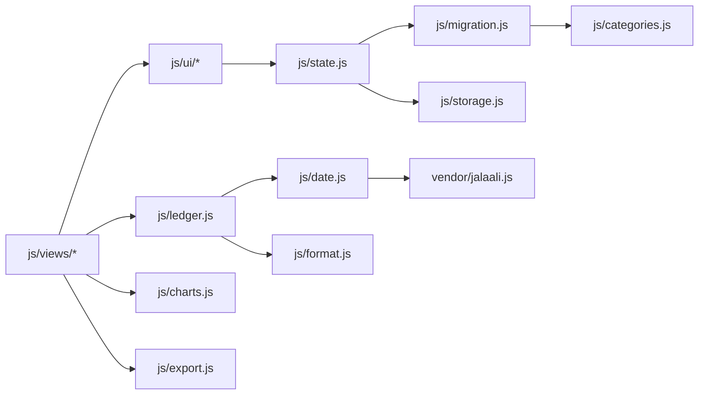

# HesabYar Technical Architecture Documentation

This document describes the internal architecture, module layout, financial accounting model, `hesabyar-v1` → `hesabyar-v2` migration specification, storage layer, and offline PWA setup.

---

## 1. Directory Structure & Dependency Graph

HesabYar is a **zero-build-step native ES Module** web application served over HTTP. Third-party dependencies are vendored in `vendor/` as self-contained browser bundles so the app works completely offline without npm or a bundler.

```text
hesabyar/
├── index.html                  # App shell, dialogs, popover root, vendor script tags
├── help.html                   # Standalone offline Persian user documentation
├── manifest.webmanifest        # PWA metadata (RTL, standalone mode, icons)
├── sw.js                       # Versioned cache-first Service Worker
├── assets/
│   ├── fonts/
│   │   ├── AradFDVF.woff2      # Variable Arad 2.5.1 font (Farsi digits, 100..900)
│   │   └── OFL.txt             # SIL Open Font License 1.1
│   └── icons/                  # SVG + 192px / 512px PNG app icons
├── vendor/
│   ├── jalaali.js              # Standalone ESM (jalaali-js v2.0.1)
│   ├── chart.umd.min.js        # Self-contained UMD (Chart.js v4.6.2)
│   ├── lucide.min.js           # Self-contained UMD (Lucide v1.79.0)
│   └── write-excel-file.min.js # Self-contained browser bundle (v4.1.1)
├── css/
│   ├── tokens.css              # @font-face, CSS custom properties, typography & reset
│   ├── layout.css              # Desktop RTL sidebar, mobile bottom nav & slide-up drawer
│   ├── components.css          # Buttons, forms, datepicker, modals, toasts, mobile-cards
│   └── views.css               # Dashboard KPIs, wallet strip, charts, budgets, theme preview
└── js/
    ├── main.js                 # Boot sequence, auto-recurring evaluation, SW registration
    ├── state.js                # Immutable-style mutation wrapper, undo restore, pub/sub
    ├── storage.js              # localStorage persistence + IndexedDB custom font store
    ├── migration.js            # PRO 3.3 (v1) -> v2 auto-migration & backup validator
    ├── date.js                 # Jalali arithmetic, clamping, calendar grid generation
    ├── format.js               # Escaping, digit normalization, caret-safe money input, CSV guard
    ├── categories.js           # Default & auto-created custom categories
    ├── ledger.js               # Pure accounting engine (carryover, obligations, budgets, recurring)
    ├── charts.js               # Theme-reactive Chart.js lifecycle wrapper
    ├── theme.js                # 8 preset themes, custom colors, FontFace + IndexedDB loader
    ├── export.js               # JSON backup, formula-safe CSV, native multi-sheet XLSX
    ├── ui/
    │   ├── icons.js            # Safe SVG rendering from window.lucide.icons
    │   ├── toast.js            # Non-blocking notification queue
    │   ├── modal.js            # Form/info dialogs, confirmDialog(), responsive table builder
    │   ├── datepicker.js       # Top-layer aware interactive Jalali calendar popover
    │   └── shell.js            # Sidebar/topbar/bottom-nav/more-drawer & backup import
    └── views/
        ├── dialogs.js          # Shared CRUD modals & partial-payment history drawer
        ├── dashboard.js        # Main financial cockpit & charts
        ├── accounts.js         # Accounts/wallets & inter-account transfers
        ├── transactions.js     # Searchable/filterable income & expense view + cash ledger
        ├── obligations.js      # Sub-tabbed Installments, Variable Bills, and Loans
        ├── budgets.js          # Category spending limits & recurring income/expense rules
        ├── reports.js          # Multi-month filter analytics + Chart.js + CSV/XLSX export
        ├── months.js           # Chronological month archive & carryover audit
        └── appearance.js       # Theme, font, size & color customization dialog
```

### Module Layering



---

## 2. Persistence & Storage Architecture

| Key / Store | Medium | Purpose |
|---|---|---|
| `hesabyar-v2` | `localStorage` | Primary JSON state (`version: 2`) |
| `hesabyar-v1` | `localStorage` | Legacy PRO 3.3 state (kept intact as read-only fallback after auto-migration) |
| `hesabyar-previous` | `localStorage` | Single-step undo snapshot updated prior to state mutations |
| `hesabyar-appearance` | `localStorage` | Theme ID, font choice (`arad` / `system` / `custom`), size (`12..20`), radius scale (`0..180`), custom hex overrides |
| `hesabyar-assets` (`fonts` store) | `IndexedDB` | Binary/DataURL storage for user-uploaded custom fonts (migrated off `localStorage` to protect financial quota) |

---

## 3. Data Schema (`version: 2`) & PRO 3.3 Migration

### Schema v2 Shape

- **`accounts[]`**: `{ id, name, type ('bank' | 'cash' | 'savings'), initialBalance, color, archived }`
- **`openingByAccount`**: `{ [YYYY-MM]: { [accountId]: number } }` — explicit manual reconciliations; omitted accounts/months inherit automatic carryover from the prior month.
- **`tx[]`**: `{ id, type ('income' | 'expense'), title, amount, date, category, accountId, recurringId? }`
- **`transfers[]`**: `{ id, fromAccountId, toAccountId, amount, date, note }`
- **`plans[]`**: `{ id, kind ('installment' | 'bill'), title, category, start, day, count, amount, defaultAccountId, overrides: { [idx]: { amount?, date? } }, payments: { [idx]: Payment[] } }`
- **`loans[]`**: `{ id, type ('lend' | 'borrow'), title, amount, given, date, accountId, payments: Payment[] }`
- **`Payment`**: `{ id, date, amount, accountId }`
- **`categories[]`**: `{ id, name, type ('income' | 'expense' | 'both'), color, icon }`
- **`budgets[]`**: `{ id, category, amount, month }` (`month === ''` means default across all months; `month === 'YYYY-MM'` overrides that specific month)
- **`recurring[]`**: `{ id, type, title, amount, category, accountId, day, start, end, autoPost, active, handledMonths: { [YYYY-MM]: 'posted' | 'skipped' } }`

### PRO 3.3 Auto-Migration (`js/migration.js`)

1. On boot, `initState()` checks `hesabyar-v2`. If absent and `hesabyar-v1` exists, `migrateV1ToV2()` runs automatically.
2. A default account (`acc_main`: `حساب اصلی`) is created and linked to all migrated transactions, plans, and loans.
3. Legacy `opening[month]` maps to `openingByAccount[month].acc_main`.
4. Legacy single-payment objects (`plan.pay[idx]` and `loan.pay`) convert into single-element `payments` arrays.
5. `normalizeBackupPayload()` accepts both PRO 3.3 (`v1`) and `v2` JSON backups cleanly during restore.

---

## 4. Accounting & Carryover Formulas (`js/ledger.js`)

### Chronological Month Carryover (`getMonthTimelineBalances`)

For each sorted month $m$ and account $a$:
1. Start with `running[a] = a.initialBalance` before the earliest month.
2. Opening balance $\text{open}(m, a)$:
   - If `openingByAccount[m][a]` is defined, use that explicit value (`source = 'manual'`).
   - Otherwise, use `running[a]` (`source = 'carryover'`).
3. Monthly delta $\Delta(m, a)$ sums **all** cash events in month $m$ for account $a$, **including** internal transfer legs (`isTransfer: true`).
4. Closing balance $\text{close}(m, a) = \text{open}(m, a) + \Delta(m, a)$ becomes `running[a]` for $m + 1$.

### Transfer Neutrality

- Transfers generate paired `-amount` / `+amount` ledger events when computing **per-account** balances and the full cash ledger.
- Aggregate monthly **inflows (`inc`)**, **outflows (`out`)**, **earned income**, and **spent expenses** exclude `isTransfer: true` events so moving money between your own cards never inflates totals.

### Partial Payment & Cutoff Math (`computeDashboardMetrics`)

For month $m$ with cutoff $\text{cut} = \min(\text{dueDate}(m, 31), \text{today})$:
- Cash inflows/outflows sum non-transfer events in `[m-01, cut]`.
- For each debt obligation (`kind !== 'lend'`), remaining obligation at cutoff is:
  $$\text{remainingAtCut}(o) = \max\Big(0,\; o.\text{amount} - \sum_{p \in o.\text{payments},\; p.\text{date} \le \text{cut}} p.\text{amount}\Big)$$
- Projected free end-of-month money (`after`) accounts for `net`, future scheduled non-transfer cash (`cut < date <= end`), open month/overdue debt (`needTotal`), and adds back debt payments already scheduled inside `(cut, end]` (`futureDebtPaidInMonth`) so planned repayments are never double-counted.

---

## 5. Security, UX & PWA Details

- **XSS & Formula Protection**: Dynamic HTML interpolates through `esc()`; interactions use `data-*` event delegation instead of inline JS strings. CSV exports escape leading `=`, `+`, `-`, `@`, `\t`, and `\r` via `csvCell()`.
- **Top-Layer Date Picker**: `js/ui/datepicker.js` dynamically re-parents `#datepickerPopover` inside `dialog[open]` whenever triggered inside a native `<dialog>.showModal()`, ensuring the Jalali calendar renders above the modal backdrop.
- **Caret-Preserving Money Input**: `attachMoneyInputs()` counts logical digits before the caret prior to inserting `٬` separators and converts digits to Persian (`۰-۹`), restoring `selectionStart`/`selectionEnd` seamlessly.
- **Offline Service Worker (`sw.js`)**: Uses a versioned cache (`hesabyar-cache-v1`) with cache-first asset serving for all HTML, CSS, ES modules, vendored libraries, `AradFDVF.woff2`, and PWA icons.
